<div align="center">

# Чистовик

### Курсовая, ВКР, реферат или отчёт по практике — сразу по ГОСТ

Заполните титульный лист, нажмите одну кнопку и пишите текст в готовом документе Word.

[](https://github.com/WiverHome/chistovik/releases/latest)
&nbsp;

&nbsp;

&nbsp;

&nbsp;
[](LICENSE.md)

**[Скачать для Windows](https://github.com/WiverHome/chistovik/releases/latest)** · [Как установить](#как-установить) · [Частые вопросы](#частые-вопросы)

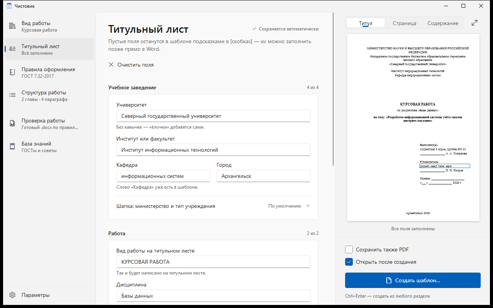

</div>

## Почему Чистовик

Оформление отнимает часы: поля, шрифты, отступы, нумерация, содержание, подписи рисунков — и всё равно нормоконтроль находит ошибки. **Чистовик** делает это за вас.

| | |
|---|---|
| **Готовый шаблон Word** | Поля, шрифты, интервалы, автосодержание, нумерация глав, рисунков и таблиц, титульный лист с вашими данными. В каждом разделе — подсказка, что в нём писать. |
| **ГОСТ по примеру и база знаний** | Не знаете требований? Загрузите работу прошлых лет или вставьте сообщение преподавателя — программа сама найдёт поля, шрифт и интервалы и скажет, на какой ГОСТ это похоже. А в базе знаний — какой ГОСТ нужен, что в нём требуется, как оформить список литературы, приёмы в Word и чек-лист нормоконтроля. |
| **Проверка перед сдачей** | Перетащите готовую работу — увидите ошибки оформления и как исправить каждую. Можно получить копию с примечаниями Word у проблемных мест. |
| **Вузы и колледжи** | 12 видов работ: от курсовой до диссертации, включая колледжи и техникумы (СПО) — с их титульными листами. |
| **ИИ-помощник** | Подключите Claude, ChatGPT, DeepSeek или другой сервис своим API-ключом: план по теме, черновики введения, параграфов и заключения, правка текста и литература по ГОСТ — прямо в шаблон. |
| **Всё на вашем компьютере** | Шаблоны, проверка и база знаний работают без интернета, файлы никуда не отправляются. ИИ-помощник — по желанию: в сервис уходит только тема, план и ваш текст, без ФИО и вуза. |

## Возможности

### Шаблон за пять минут

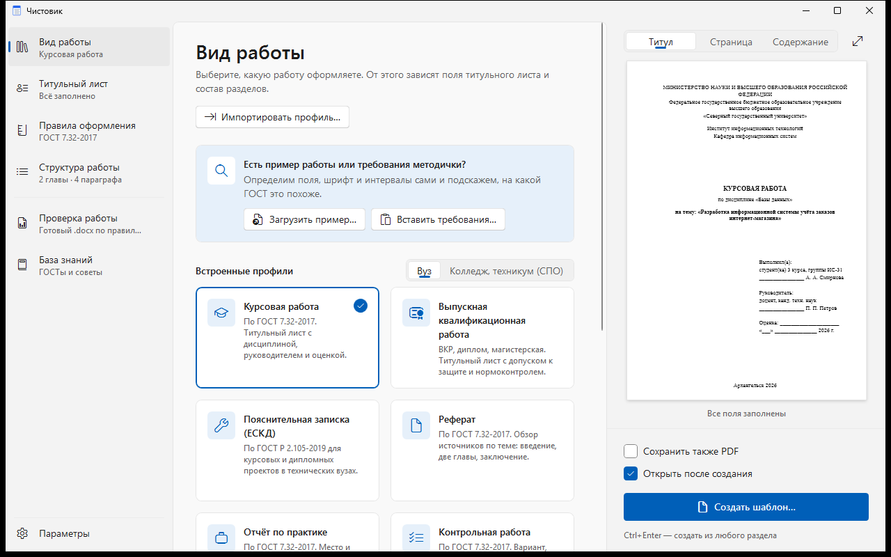

1. **Вид работы** — курсовая, ВКР, реферат, отчёт по практике… Вуз или колледж — переключатель над карточками.
2. **Титульный лист** — заполните, что знаете. Пустые поля останутся в шаблоне подсказками в [скобках].
3. **Правила оформления** — по умолчанию по ГОСТу; поменяйте только то, чего требует методичка.
4. **Структура работы** — главы, параграфы, введение, приложения.
5. **Создать шаблон…** (`Ctrl+Enter`) — откроется документ Word, в котором уже всё настроено.

Справа всё время виден лист: титульный лист, схема страницы с полями или содержание. Всё введённое сохраняется само.

<table>
  <tr>
    <td width="50%">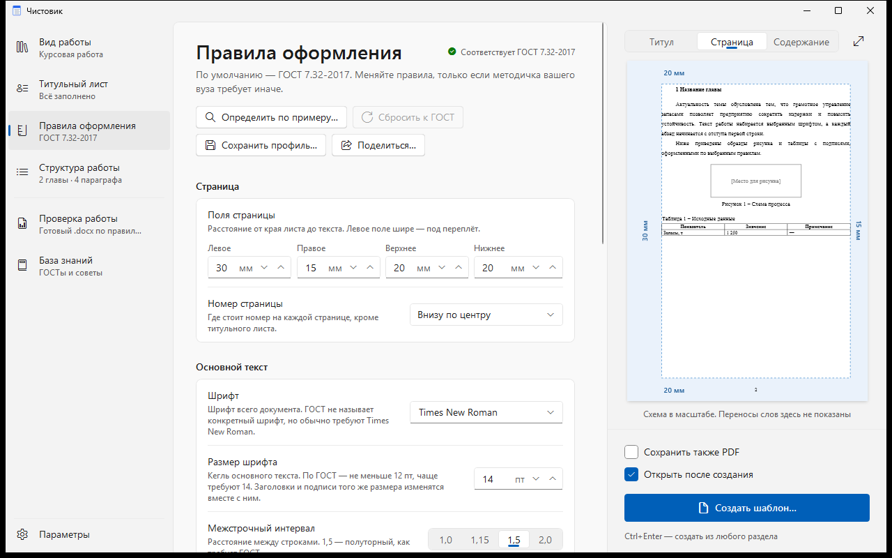</td>
    <td width="50%">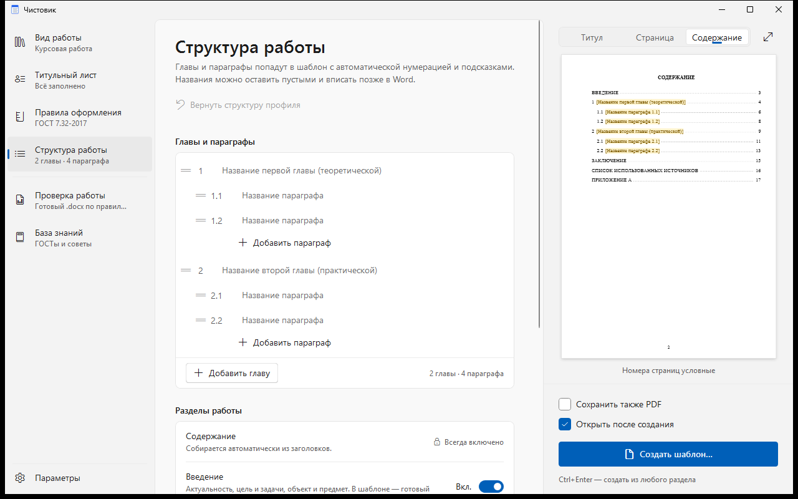</td>
  </tr>
  <tr>
    <td align="center"><sub>Правила оформления — со схемой страницы в масштабе</sub></td>
    <td align="center"><sub>Структура — главы и параграфы перетаскиваются мышью</sub></td>
  </tr>
</table>

### Не знаете, какой у вас ГОСТ?

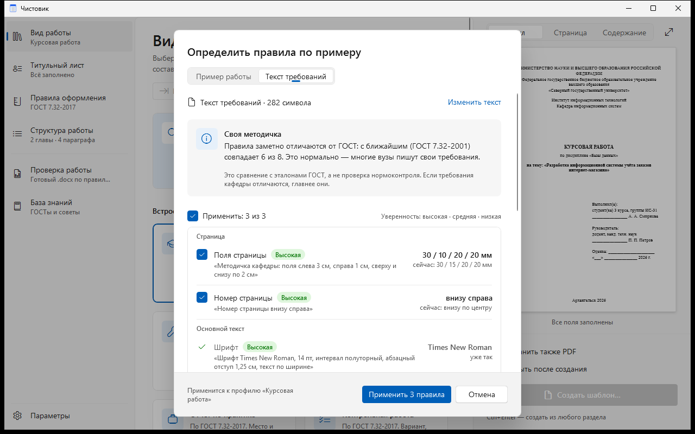

Часто вместо методички присылают сообщение: *«поля 3 см слева, шрифт 14, интервал полуторный»*. Вставьте его — или загрузите пример работы (.docx, PDF; .doc, .rtf и .odt — если установлен Word).

- Программа найдёт **поля, шрифт, интервал, отступы, выравнивание, номера страниц, заголовки и подписи** — с цитатой из требований или долей текста, на которой это видно.
- Скажет, **на какой ГОСТ это похоже** — или честно: «своя методичка».
- Применить можно галочками, отменить — одной кнопкой. Если пример похож на диссертацию или пояснительную записку ЕСКД, программа предложит сменить вид работы.

### Проверка готовой работы

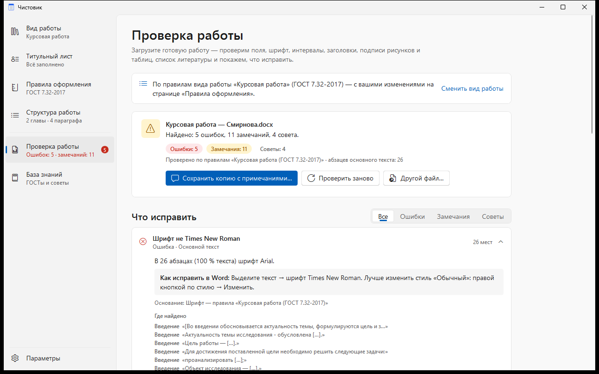

Перетащите готовый .docx в раздел **«Проверка работы»** (`Ctrl+5`). Около 30 проверок по правилам выбранного вида работы:

| Что проверяется | |
|---|---|
| **Страница** | формат А4, поля, номера страниц, номер на титульном листе |
| **Текст** | шрифт, размер, интервал, абзацный отступ, выравнивание, пустые строки, двойные пробелы, дефис вместо тире |
| **Заголовки** | прописные или нет, положение, точка в конце, глава с новой страницы, автособираемое содержание |
| **Рисунки и таблицы** | подписи «Рисунок 1 – …», нумерация без пропусков, ссылки на них в тексте |
| **Список литературы** | «URL:» и дата обращения у сайтов, ссылки [N] в тексте — по ГОСТ Р 7.0.100, 7.0.5, 7.0.108 |
| **Приложения** | буквы без Ё, З, Й, О, Ч, Ъ, Ы, Ь и порядок |

У каждого замечания — **где оно найдено** и **как исправить в Word**. Кнопка «Сохранить копию с примечаниями» сделает копию работы с примечаниями Word прямо у проблемных абзацев. Исходный файл не меняется.

### ИИ-помощник

<table>
  <tr>
    <td width="50%">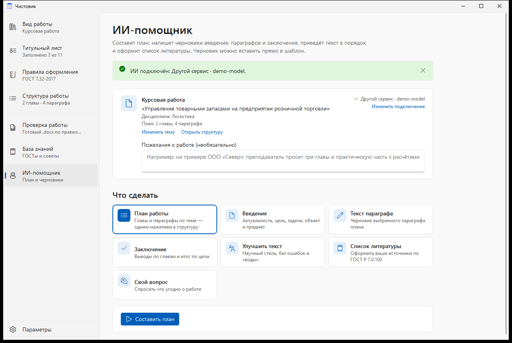</td>
    <td width="50%">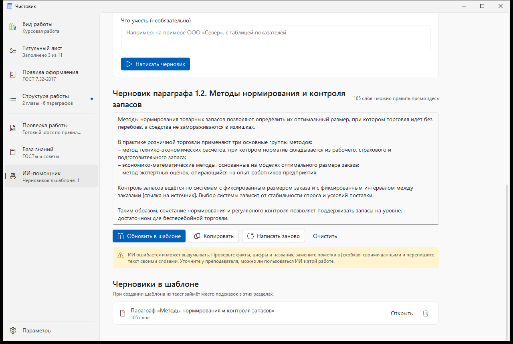</td>
  </tr>
  <tr>
    <td align="center"><sub>Тема и план берутся из титула и структуры — выберите задачу</sub></td>
    <td align="center"><sub>Черновик правится прямо в окне и вставляется в шаблон</sub></td>
  </tr>
</table>

Подключите сервис ИИ своим API-ключом в разделе **«ИИ-помощник»** (`Ctrl+7`) — Claude, ChatGPT, DeepSeek, OpenRouter или любой сервис, совместимый с OpenAI, в том числе модель на своём компьютере (Ollama, LM Studio).

| Задача | Что получится |
|---|---|
| **План работы** | главы и параграфы по теме — кнопкой «Применить к структуре» |
| **Введение** | актуальность, цель, задачи по плану, объект, предмет, методы |
| **Текст параграфа** | черновик выбранного параграфа нужного объёма |
| **Заключение** | выводы по главам и итог по цели |
| **Улучшить текст** | ваш абзац — в научном стиле, без повторов и ошибок |
| **Список литературы** | ваши источники — по ГОСТ Р 7.0.100-2018 |

Черновик можно поправить прямо в окне и **вставить в шаблон**: при создании документа он займёт место подсказки в своём разделе. ИИ просят не выдумывать факты и источники — на их месте он ставит пометки вроде *[привести данные]*. Ключ хранится только на вашем компьютере в зашифрованном виде.

> Черновик ИИ — отправная точка, а не готовая работа. Проверьте факты, перепишите текст своими словами и уточните у преподавателя, можно ли пользоваться ИИ.

### Виды работ

**Для вузов**

| Вид работы | Оформление по |
|---|---|
| Курсовая работа | ГОСТ 7.32-2017 |
| Выпускная квалификационная работа (бакалавр, специалист, магистр) | ГОСТ 7.32-2017 |
| Реферат | ГОСТ 7.32-2017 |
| Отчёт по практике | ГОСТ 7.32-2017 |
| Контрольная работа | ГОСТ 7.32-2017 |
| Пояснительная записка к проекту (технические вузы) | ГОСТ Р 2.105-2019 (ЕСКД) |
| Диссертация | ГОСТ Р 7.0.11-2011 |

**Для колледжей и техникумов (СПО)** — оформление по ГОСТ 7.32-2017, титульные листы колледжа

| Вид работы | Что на титульном листе |
|---|---|
| Курсовая работа (проект) | учредитель, колледж, МДК, специальность, преподаватель |
| Дипломная работа (проект) | «Согласовано» — председатель ПЦК, «К защите допустить» — заместитель директора |
| Отчёт по практике | профессиональный модуль, вид практики, руководитель от организации |
| Индивидуальный проект | учебный предмет, руководитель; в структуре — продукт проекта |
| Реферат | учредитель, колледж, специальность, преподаватель |

<p align="center">
  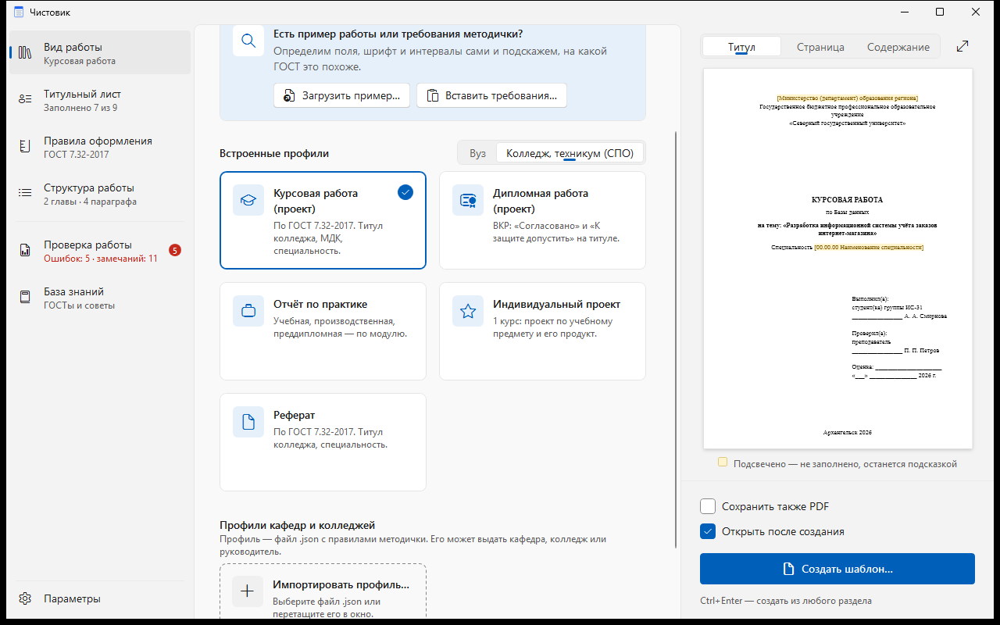
  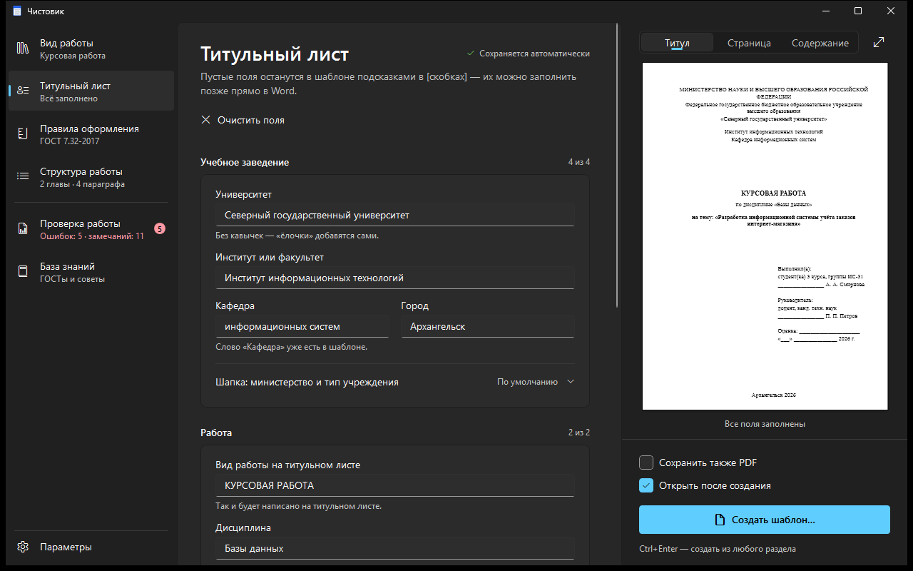
  <br><sub>Виды работ для колледжа · тёмная тема</sub>
</p>

У кафедры свои требования? Настройте правила и структуру и нажмите **«Поделиться…»** — получится файл профиля .json. Студенты откроют его в Чистовике, и у всех будет одинаковое оформление.

### База знаний

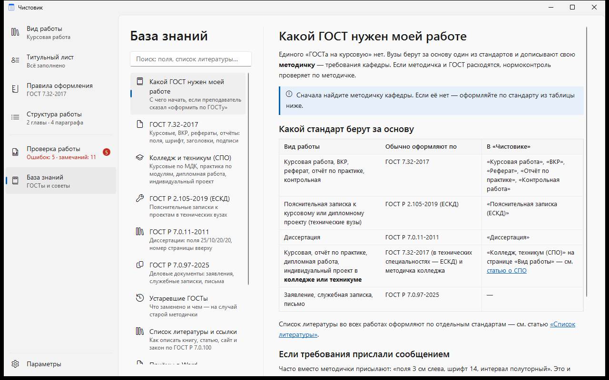

Внутри программы (`F1`): какой ГОСТ нужен вашей работе, требования **ГОСТ 7.32-2017, Р 2.105-2019, Р 7.0.11-2011, Р 7.0.97-2025**, чем отличаются устаревшие стандарты, образцы списка литературы, приёмы в Word, чек-лист нормоконтроля и всё о работах в колледже. При первом запуске — короткое обучение.

Подробный справочник со ссылками на тексты стандартов — [design/GOSTS.md](design/GOSTS.md).

## Как установить

**Нужно:** Windows 10 или 11 (64-бит). .NET устанавливать не нужно. Microsoft Word — для открытия шаблона; без него программа тоже работает и сохраняет .docx.

1. Откройте [последний выпуск](https://github.com/WiverHome/chistovik/releases/latest).
2. Скачайте **`Chistovik-x.y.z.msi`** и запустите. Права администратора не нужны — программа ставится только для вас. Или скачайте **`Chistovik.exe`** и запускайте без установки.
3. Найдите «Чистовик» в меню «Пуск» или на рабочем столе.

> **Windows защитила ваш компьютер?** Нажмите «Подробнее» → «Выполнить в любом случае». У программы пока нет цифровой подписи — поэтому SmartScreen её не узнаёт.

## Частые вопросы

<details>
<summary><b>Это бесплатно?</b></summary>

Да. Программа бесплатная, без рекламы и регистрации. Её можно ставить на любые свои компьютеры и в компьютерных классах — подробности в [лицензионном соглашении](LICENSE.md).
</details>

<details>
<summary><b>Нужен ли Microsoft Word?</b></summary>

Шаблон — обычный файл .docx: его откроют Word, LibreOffice или «Мой Офис». Если Word установлен, «Чистовик» сразу обновит в шаблоне содержание и нумерацию и при желании сохранит PDF. Без Word содержание обновится при открытии файла в Word, а в других редакторах — командой обновления полей.
</details>

<details>
<summary><b>У нас своя методичка, а не ГОСТ. Подойдёт?</b></summary>

Да. Вставьте требования методички текстом или загрузите пример работы — правила определятся сами. Или настройте их вручную на странице «Правила оформления». Методичка кафедры главнее ГОСТа, и программа это учитывает.
</details>

<details>
<summary><b>Куда уходят мои данные?</b></summary>

Титульный лист, правила и проверяемые файлы обрабатываются только на вашем компьютере. Настройки хранятся в папке `%APPDATA%\Chistovik`. Если подключить ИИ-помощник, в выбранный вами сервис уходят вид работы, тема, дисциплина, план и текст, который вы сами вставили, — ФИО, вуз и группа не отправляются.
</details>

<details>
<summary><b>ИИ-помощник платный?</b></summary>

Сама программа бесплатна. Запросы к ИИ оплачиваются по тарифам выбранного сервиса с баланса вашего ключа. Бесплатный вариант — модель на своём компьютере через Ollama или LM Studio (пункт «Другой сервис»).
</details>

<details>
<summary><b>Проверка гарантирует, что нормоконтроль пройдёт?</b></summary>

Нет — она находит ошибки оформления, которые проверяют чаще всего, и сверяет работу с выбранными правилами. Титульный лист, формулы, содержание и требования конкретной кафедры посмотрите сами.
</details>

<details>
<summary><b>Я учусь в колледже. Есть шаблоны для СПО?</b></summary>

Да: на странице «Вид работы» выберите «Колледж, техникум (СПО)». Будут курсовая работа (проект), дипломная работа (проект), отчёт по практике, индивидуальный проект и реферат с титульными листами колледжа.
</details>

<details>
<summary><b>Раньше программа называлась «Конструктор шаблонов работ»?</b></summary>

Да. При первом запуске «Чистовик» сам переносит ваши данные из старой версии.
</details>

## Для разработчиков

### Устройство проекта

| Папка | Что внутри |
|---|---|
| `src/ShablonRabot.Core` | Модель профиля, генератор .docx (OpenXML), встроенные профили (`Profiles/*.json`), определение правил по примеру (`Detection/`), проверка готовой работы (`Checking/`), ИИ-помощник (`Ai/`: клиент API Anthropic и OpenAI, подсказки, черновики) |
| `src/ShablonRabot.App` | Приложение WPF (.NET 8): MVVM, светлая и тёмная темы, база знаний (`Knowledge/*.md`) |
| `src/ShablonRabot.Cli` | Консольная утилита `shablon`: сборка шаблона, определение правил, проверка работы |
| `installer` | Установщик MSI (WiX 5) для текущего пользователя |
| `design` | Спецификация интерфейса, аудиты UX/UI, справочник ГОСТов |
| `docs` | Баннер и скриншоты для этой страницы |

### Сборка

```powershell
dotnet tool install --global wix --version 5.0.2
wix extension add -g WixToolset.UI.wixext/5.0.2
.\build.ps1 -Version 1.4.1
```

Результат — в `dist`: самодостаточный `Chistovik.exe` и MSI-установщик.

### Консольная утилита

```powershell
# шаблон без интерфейса
dotnet run --project src/ShablonRabot.Cli -- kursovaya -o Курсовая.docx --pdf --validate
# определить правила по примеру или тексту требований
dotnet run --project src/ShablonRabot.Cli -- detect пример.docx
dotnet run --project src/ShablonRabot.Cli -- detect --text "Поля: левое — 30 мм, правое — 15 мм…"
# проверить готовую работу и сохранить копию с примечаниями
dotnet run --project src/ShablonRabot.Cli -- check работа.docx --profile kursovaya --annotate замечания.docx
```

Профили — `src/ShablonRabot.Core/Profiles/*.json`; ключ `extends` наследует базовый профиль, `field_hints` меняет подписи полей титула.

### Проверка без риска для своих данных

Переменная окружения `CHISTOVIK_DATA_DIR` задаёт программе отдельную папку настроек вместо `%APPDATA%\Chistovik` — удобно для тестов: ваши настройки и ключ ИИ не затрагиваются, перенос данных старой версии отключён.

```powershell
$env:CHISTOVIK_DATA_DIR = "$env:TEMP\chistovik-test"; .\dist\Chistovik.exe
```

### Лицензия в установщике

Окно лицензии в MSI собирается из `LICENSE.md` скриптом `installer/make-license.ps1` при каждом запуске `build.ps1`. Меняйте текст только в `LICENSE.md`.

## Лицензия

© 2026 WiverHome. Все права защищены. Полный текст — [LICENSE.md](LICENSE.md); лицензии сторонних компонентов (.NET, Open XML SDK, PdfPig) — [THIRD-PARTY-NOTICES.md](THIRD-PARTY-NOTICES.md).

«Чистовик» бесплатен: его можно скачивать, устанавливать на любые свои компьютеры и в компьютерных классах. Документы, которые вы создали в программе, принадлежат вам. Продавать программу, распространять изменённые версии и копировать код, тексты и изображения в другие проекты нельзя без письменного разрешения. Исходный код открыт для просмотра, но это не открытая лицензия.
