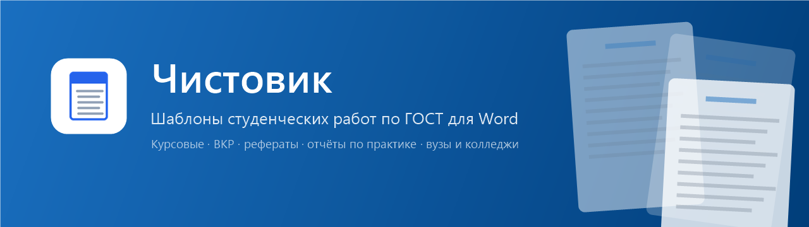

<p align="center">
  
</p>

<p align="center">
  <a href="https://github.com/WiverHome/chistovik/releases/latest"></a>
  
  
  
  
</p>

<h3 align="center">
  Курсовая, ВКР, реферат или отчёт по практике — сразу по ГОСТ.<br>
  Заполните титульный лист, нажмите одну кнопку и пишите текст в готовом документе Word.
</h3>

<p align="center">
  <a href="https://github.com/WiverHome/chistovik/releases/latest"><b>⬇&nbsp;&nbsp;Скачать для Windows</b></a>
  &nbsp;·&nbsp;
  <a href="#-как-установить">Как установить</a>
  &nbsp;·&nbsp;
  <a href="#-частые-вопросы">Вопросы</a>
</p>

<p align="center">
  
</p>

---

## Зачем это

Оформление отнимает часы: поля, шрифты, отступы, нумерация, содержание, подписи рисунков — и всё равно нормоконтроль находит ошибки. **Чистовик** делает это за вас:

<table>
  <tr>
    <td width="50%" valign="top">📄 <b>Готовый шаблон Word</b><br>Поля, шрифты, интервалы, автосодержание, нумерация глав, рисунков и таблиц, титульный лист с вашими данными. В каждом разделе — подсказка, что в нём писать.</td>
    <td width="50%" valign="top">🔎 <b>ГОСТ по примеру</b><br>Не знаете требований? Загрузите работу прошлых лет или вставьте сообщение преподавателя — программа сама найдёт поля, шрифт и интервалы и скажет, на какой ГОСТ это похоже.</td>
  </tr>
  <tr>
    <td valign="top">✅ <b>Проверка перед сдачей</b><br>Перетащите готовую работу — увидите ошибки оформления и как исправить каждую. Можно получить копию с примечаниями Word у проблемных мест.</td>
    <td valign="top">🎓 <b>Вузы и колледжи</b><br>12 видов работ: от курсовой до диссертации, включая колледжи и техникумы (СПО) — с их титульными листами.</td>
  </tr>
  <tr>
    <td valign="top">📚 <b>База знаний</b><br>Какой ГОСТ нужен, что в нём требуется, как оформить список литературы, приёмы в Word и чек-лист нормоконтроля.</td>
    <td valign="top">🔒 <b>Всё на вашем компьютере</b><br>Файлы и данные никуда не отправляются. Интернет не нужен.</td>
  </tr>
</table>

---

## 📄 Шаблон за пять минут


1. **Вид работы** — курсовая, ВКР, реферат, отчёт по практике… Вуз или колледж — переключатель над карточками.
2. **Титульный лист** — заполните, что знаете. Пустые поля останутся в шаблоне подсказками в [скобках].
3. **Правила оформления** — по умолчанию по ГОСТу; поменяйте только то, чего требует методичка.
4. **Структура работы** — главы, параграфы, введение, приложения.
5. **Создать шаблон…** (`Ctrl+Enter`) — откроется документ Word, в котором уже всё настроено.

Справа всё время виден лист: титульный лист, схема страницы с полями или содержание. Всё введённое сохраняется само.

<table>
  <tr>
    <td width="50%"></td>
    <td width="50%"></td>
  </tr>
  <tr>
    <td align="center"><sub>Правила оформления — со схемой страницы в масштабе</sub></td>
    <td align="center"><sub>Структура — главы и параграфы перетаскиваются мышью</sub></td>
  </tr>
</table>

---

## 🔎 Не знаете, какой у вас ГОСТ?


Часто вместо методички присылают сообщение: *«поля 3 см слева, шрифт 14, интервал полуторный»*. Вставьте его — или загрузите пример работы (.docx, PDF; .doc, .rtf и .odt — если установлен Word).

- Программа найдёт **поля, шрифт, интервал, отступы, выравнивание, номера страниц, заголовки и подписи** — с цитатой из требований или долей текста, на которой это видно.
- Скажет, **на какой ГОСТ это похоже** — или честно: «своя методичка».
- Применить можно галочками, отменить — одной кнопкой. Если пример похож на диссертацию или пояснительную записку ЕСКД, программа предложит сменить вид работы.

---

## ✅ Проверка готовой работы


Перетащите готовый .docx в раздел **«Проверка работы»** (`Ctrl+5`). Около 30 проверок по правилам выбранного вида работы:

| Что проверяется | |
|---|---|
| **Страница** | формат А4, поля, номера страниц, номер на титульном листе |
| **Текст** | шрифт, размер, интервал, абзацный отступ, выравнивание, пустые строки, двойные пробелы, дефис вместо тире |
| **Заголовки** | прописные или нет, положение, точка в конце, глава с новой страницы, автособираемое содержание |
| **Рисунки и таблицы** | подписи «Рисунок 1 – …», нумерация без пропусков, ссылки на них в тексте |
| **Список литературы** | «URL:» и дата обращения у сайтов, ссылки [N] в тексте — по ГОСТ Р 7.0.100, 7.0.5, 7.0.108 |
| **Приложения** | буквы без Ё, З, Й, О, Ч, Ъ, Ы, Ь и порядок |

У каждого замечания — **где оно найдено** и **как исправить в Word**. Кнопка «Сохранить копию с примечаниями» сделает копию работы с примечаниями Word прямо у проблемных абзацев. Исходный файл не меняется.

---

## 🎓 Виды работ

**Для вузов**

| Вид работы | Оформление по |
|---|---|
| Курсовая работа | ГОСТ 7.32-2017 |
| Выпускная квалификационная работа (бакалавр, специалист, магистр) | ГОСТ 7.32-2017 |
| Реферат | ГОСТ 7.32-2017 |
| Отчёт по практике | ГОСТ 7.32-2017 |
| Контрольная работа | ГОСТ 7.32-2017 |
| Пояснительная записка к проекту (технические вузы) | ГОСТ Р 2.105-2019 (ЕСКД) |
| Диссертация | ГОСТ Р 7.0.11-2011 |

**Для колледжей и техникумов (СПО)** — оформление по ГОСТ 7.32-2017, титульные листы колледжа

| Вид работы | Что на титульном листе |
|---|---|
| Курсовая работа (проект) | учредитель, колледж, МДК, специальность, преподаватель |
| Дипломная работа (проект) | «Согласовано» — председатель ПЦК, «К защите допустить» — заместитель директора |
| Отчёт по практике | профессиональный модуль, вид практики, руководитель от организации |
| Индивидуальный проект | учебный предмет, руководитель; в структуре — продукт проекта |
| Реферат | учредитель, колледж, специальность, преподаватель |

<p align="center">
  
  
  <br><sub>Виды работ для колледжа · тёмная тема</sub>
</p>

У кафедры свои требования? Настройте правила и структуру и нажмите **«Поделиться…»** — получится файл профиля .json. Студенты откроют его в Чистовике, и у всех будет одинаковое оформление.

---

## 📚 База знаний


Внутри программы (`F1`): какой ГОСТ нужен вашей работе, требования **ГОСТ 7.32-2017, Р 2.105-2019, Р 7.0.11-2011, Р 7.0.97-2025**, чем отличаются устаревшие стандарты, образцы списка литературы, приёмы в Word, чек-лист нормоконтроля и всё о работах в колледже. При первом запуске — короткое обучение.

Подробный справочник со ссылками на тексты стандартов — [design/GOSTS.md](design/GOSTS.md).

---

## ⬇ Как установить

1. Откройте [последний выпуск](https://github.com/WiverHome/chistovik/releases/latest).
2. Скачайте **`Chistovik-x.y.z.msi`** и запустите. Права администратора не нужны — программа ставится только для вас. Или скачайте **`Chistovik.exe`** и запускайте без установки.
3. Найдите «Чистовик» в меню «Пуск» или на рабочем столе.

> **Windows защитила ваш компьютер?** Нажмите «Подробнее» → «Выполнить в любом случае». У программы пока нет цифровой подписи — поэтому SmartScreen её не узнаёт.

**Нужно:** Windows 10 или 11 (64-бит). .NET устанавливать не нужно. Microsoft Word — для открытия шаблона; без него программа тоже работает и сохраняет .docx.

---

## ❓ Частые вопросы

<details>
<summary><b>Это бесплатно?</b></summary>

Да. Программа бесплатная, без рекламы и регистрации.
</details>

<details>
<summary><b>Нужен ли Microsoft Word?</b></summary>

Шаблон — обычный файл .docx: его откроют Word, LibreOffice или «Мой Офис». Если Word установлен, «Чистовик» сразу обновит в шаблоне содержание и нумерацию и при желании сохранит PDF. Без Word содержание обновится при открытии файла в Word, а в других редакторах — командой обновления полей.
</details>

<details>
<summary><b>У нас своя методичка, а не ГОСТ. Подойдёт?</b></summary>

Да. Вставьте требования методички текстом или загрузите пример работы — правила определятся сами. Или настройте их вручную на странице «Правила оформления». Методичка кафедры главнее ГОСТа, и программа это учитывает.
</details>

<details>
<summary><b>Куда уходят мои данные?</b></summary>

Никуда. Титульный лист, правила и проверяемые файлы обрабатываются только на вашем компьютере. Настройки хранятся в папке `%APPDATA%\Chistovik`.
</details>

<details>
<summary><b>Проверка гарантирует, что нормоконтроль пройдёт?</b></summary>

Нет — она находит ошибки оформления, которые проверяют чаще всего, и сверяет работу с выбранными правилами. Титульный лист, формулы, содержание и требования конкретной кафедры посмотрите сами.
</details>

<details>
<summary><b>Я учусь в колледже. Есть шаблоны для СПО?</b></summary>

Да: на странице «Вид работы» выберите «Колледж, техникум (СПО)». Будут курсовая работа (проект), дипломная работа (проект), отчёт по практике, индивидуальный проект и реферат с титульными листами колледжа.
</details>

<details>
<summary><b>Раньше программа называлась «Конструктор шаблонов работ»?</b></summary>

Да. При первом запуске «Чистовик» сам переносит ваши данные из старой версии.
</details>

---

<details>
<summary><b>🛠 Для разработчиков</b></summary>

### Устройство проекта

| Папка | Что внутри |
|---|---|
| `src/ShablonRabot.Core` | Модель профиля, генератор .docx (OpenXML), встроенные профили (`Profiles/*.json`), определение правил по примеру (`Detection/`), проверка готовой работы (`Checking/`) |
| `src/ShablonRabot.App` | Приложение WPF (.NET 8): MVVM, светлая и тёмная темы, база знаний (`Knowledge/*.md`) |
| `src/ShablonRabot.Cli` | Консольная утилита `shablon`: сборка шаблона, определение правил, проверка работы |
| `installer` | Установщик MSI (WiX 5) для текущего пользователя |
| `design` | Спецификация интерфейса, аудиты UX/UI, справочник ГОСТов |
| `docs` | Баннер и скриншоты для этой страницы |

### Сборка

```powershell
dotnet tool install --global wix --version 5.0.2
wix extension add -g WixToolset.UI.wixext/5.0.2
.\build.ps1 -Version 1.3.1
```

Результат — в `dist`: самодостаточный `Chistovik.exe` и MSI-установщик.

### Консольная утилита

```powershell
# шаблон без интерфейса
dotnet run --project src/ShablonRabot.Cli -- kursovaya -o Курсовая.docx --pdf --validate
# определить правила по примеру или тексту требований
dotnet run --project src/ShablonRabot.Cli -- detect пример.docx
dotnet run --project src/ShablonRabot.Cli -- detect --text "Поля: левое — 30 мм, правое — 15 мм…"
# проверить готовую работу и сохранить копию с примечаниями
dotnet run --project src/ShablonRabot.Cli -- check работа.docx --profile kursovaya --annotate замечания.docx
```

Профили — `src/ShablonRabot.Core/Profiles/*.json`; ключ `extends` наследует базовый профиль, `field_hints` меняет подписи полей титула.

</details>
